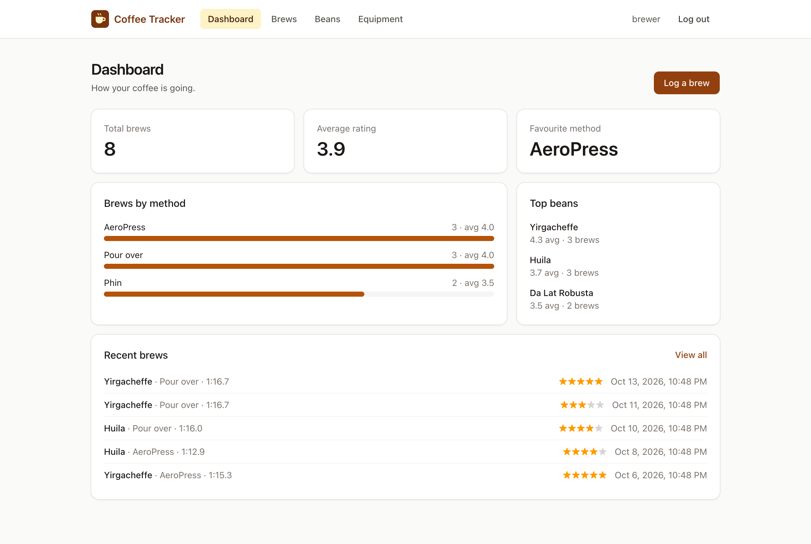
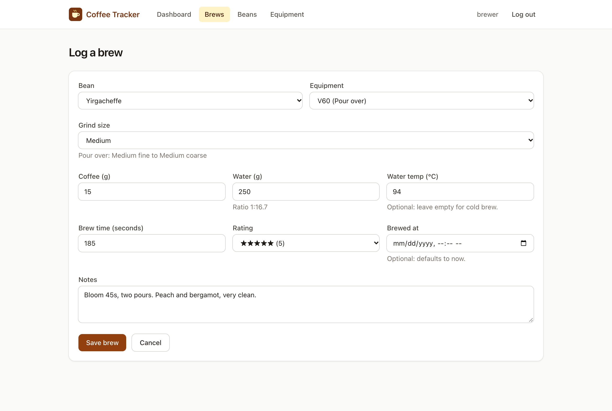
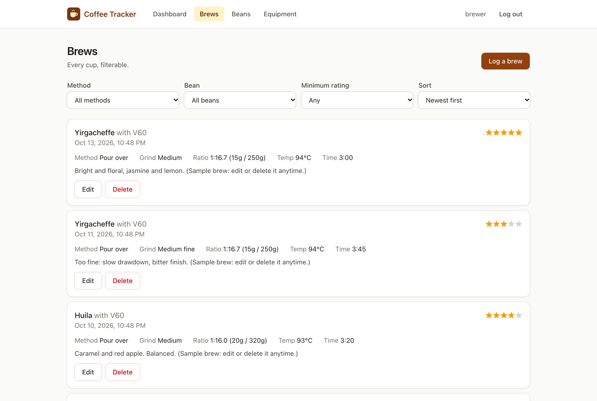
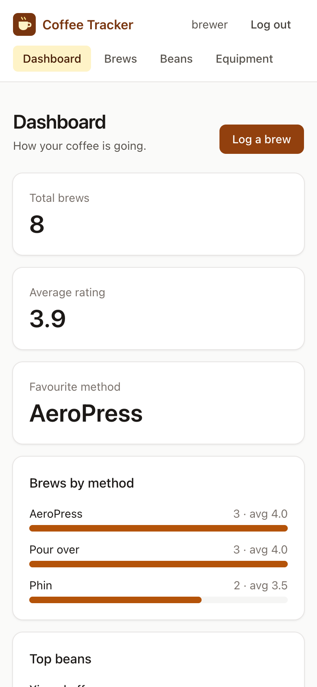

# Coffee Tracker

A full-stack app for logging coffee brews (AeroPress, Vietnamese phin, pour-over,
espresso…) and the parameters behind them: beans, equipment, grind size, coffee-to-water
ratio, temperature, time, and how good the cup was.

**Live: [coffee.hassanhibbert.com](https://coffee.hassanhibbert.com)**. Click **Try the demo** to
look around a read-only account full of brews, or create your own account (it starts with sample
data you can edit or delete).



| | Stack | Docs |
|---|---|---|
| **[`server/`](server)** | Java 21 · Spring Boot 4.1 · PostgreSQL · Flyway · Spring Security (JWT) · Testcontainers | [server/README.md](server/README.md) |
| **[`client/`](client)** | React 19 · TypeScript · Vite · TanStack Query · React Router · Tailwind CSS · Vitest | [client/README.md](client/README.md) |

## Screenshots

| Log a brew: live ratio and the grind range for the chosen method | Every brew, filterable | Phone |
|---|---|---|
|  |  |  |

## Highlights

- **Typed end to end.** The client's TypeScript types are generated from the server's
  OpenAPI spec, so a change to a Java DTO surfaces as a compile error in React.
- **Secure by default.** JWT auth, per-user data isolation (IDOR-safe), BCrypt, CORS
  allow-list, and a strict Content-Security-Policy on the client.
- **Isolation, proven.** An integration test signs in as two real users and tries every
  endpoint against the other's data: all 404s. It was checked by breaking an ownership query
  on purpose and watching it fail.
- **Abuse-resistant sign-in.** Login is rate limited per IP and per username, sign-up per IP
  (token buckets, `429` + `Retry-After`), using the real client IP behind the proxy so a
  spoofed `X-Forwarded-For` doesn't buy a fresh limit.
- **A demo that can't be vandalised.** One click, no password: the demo token carries a
  `demo` scope and the server refuses its writes, so every visitor sees the same clean data.
- **Validated twice, explained once.** Bean Validation and Postgres `CHECK` constraints on
  the server; the client renders the server's RFC 9457 errors next to the right fields.
- **Tested at every layer.** JUnit/Mockito units, Spring slice tests, Testcontainers
  against real Postgres, and React Testing Library + MSW on the client.
- **Deployable.** Dockerfile + Render Blueprint (API, database), the client on DreamHost, and GitHub
  Actions CI for both apps.

## Quick start

Requirements: JDK 21, Node 22+, PostgreSQL. Docker is optional (for Testcontainers tests).

```bash
# 1. API on :8080
cd server
createdb coffee_tracker
export JWT_SECRET=$(openssl rand -base64 48)
./mvnw spring-boot:run

# 2. Client on :5173 (in a second terminal)
cd client
npm install
npm run dev
```

Open http://localhost:5173 and click **Try the demo**, or create an account (it starts with
sample brews).
API docs: http://localhost:8080/swagger-ui.html.

## Repository layout

```
.
├── server/                 Spring Boot API (Maven), Dockerfile
├── client/                 React app (Vite), deployed to DreamHost with scripts/deploy.sh
├── docs/screenshots/       Images used in this README
├── render.yaml             Render Blueprint: Postgres + API
└── .github/workflows/      CI: server (tests + Docker build) and client (lint, test, build)
```
